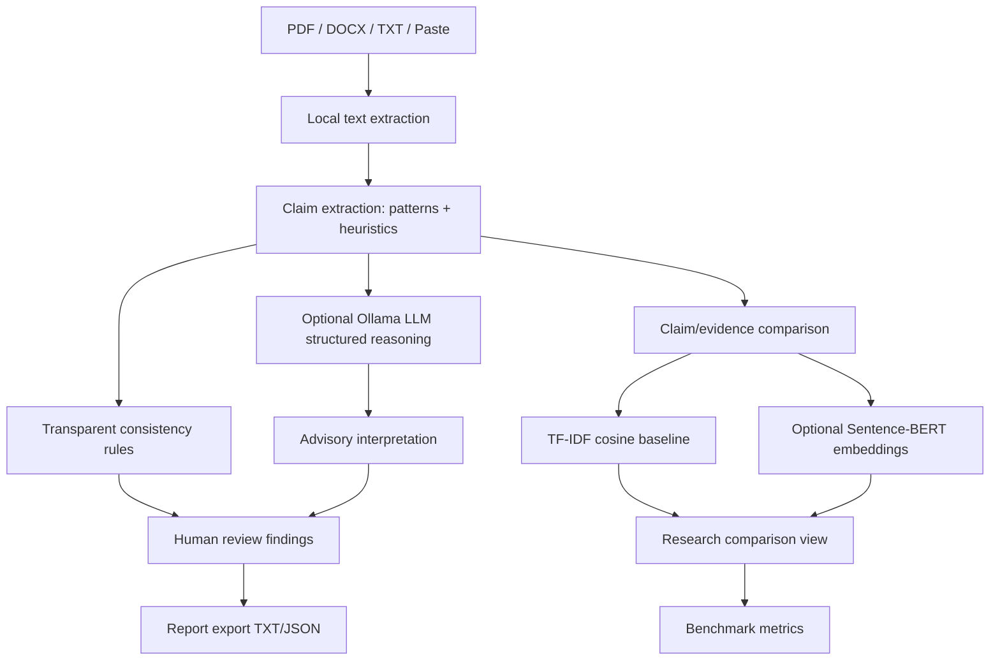

# Architecture and data flow

## Component choices
| Component | Technique | Rationale | Limitation |
|---|---|---|---|
| Text parsing | pypdf/python-docx | Local, lightweight | Scanned PDFs require OCR (not included) |
| Claim extraction | Rules/patterns | Explainable baseline | Not robust NER |
| Timeline | Chronological rules | Reproducible | Incomplete dates/layouts may be missed |
| Evidence baseline | TF-IDF + cosine | Transparent, fast benchmark baseline | Lexical, poor paraphrase understanding |
| Semantic baseline | all-MiniLM-L6-v2 Sentence-BERT | Embedding-based semantic similarity | Optional model download; similarity ≠ truth |
| Reasoning | Local Ollama LLM with JSON prompt | Privacy-conscious, structured explanation | Model can hallucinate; local availability |
| UI | Streamlit | Quick prototype and demonstration | Not production deployment |
| Evaluation | Threshold sweep; accuracy/precision/recall/F1 | Reproducible comparison | Synthetic small benchmark, no generalization |

Privacy: resume content stays in local app processing; the optional Ollama model is local. No external verification or cloud LLM is called by this project code.
